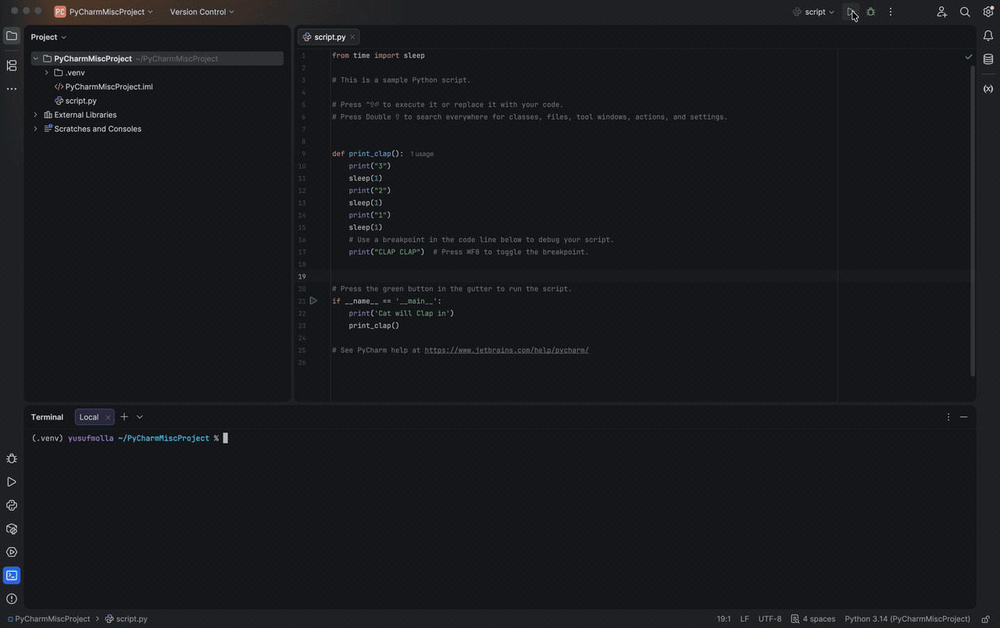
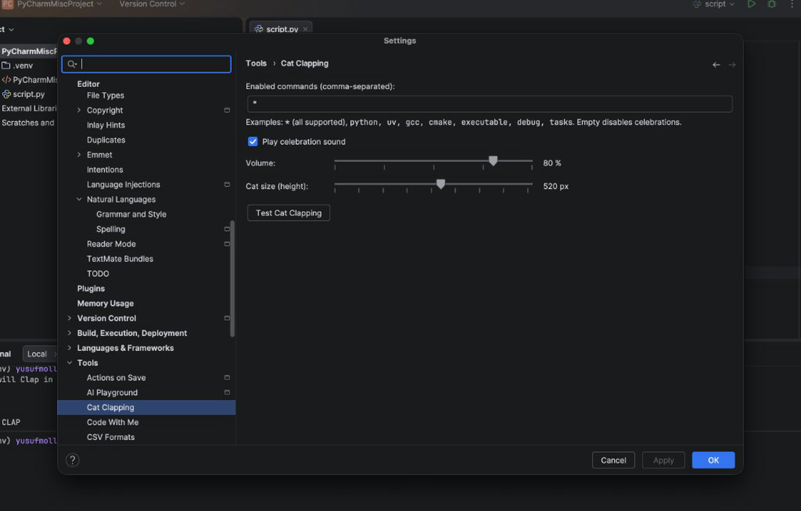

# Cat Clapping

Celebrate successful builds, runs, tests, and debug sessions with a clapping cat and sound effect.

This repository contains both the **VS Code extension** and the **JetBrains IDE plugin** (PyCharm, CLion, IntelliJ IDEA, WebStorm, etc.) for **macOS, Linux, and Windows**.

## Preview





## Repository Structure

- `extension/` — Original VS Code extension (`cat-clapping` by `nicosmartworking` / Nicola, see [extension/LICENSE.txt](extension/LICENSE.txt))
- `jetbrains-plugin/` — JetBrains Platform plugin (PyCharm, CLion, IntelliJ IDEA, etc.) by Yusuf Molla

## JetBrains Plugin (PyCharm, CLion, ...)

### Features

- Animated clapping cat overlay at the top center of the active editor + celebration sound
- Detects successful **Run / Debug / Test** sessions (`ExecutionManager.EXECUTION_TOPIC`)
- Detects successful **IDE Builds** (`BuildViewManager`, e.g. CMake / Make / Gradle)
- Detects successful **Terminal commands** via JetBrains shell integration (new Terminal, IDE 2025.3+), including:
  - **Python:** `python`, `python3`, `py`, `pytest`, `uv run`, `uvx`, `uv build`, `poetry run`, `pdm run`, `pipenv run`
  - **C / C++ (macOS, Linux, Windows):** `gcc`, `cc`, `clang`, `g++`, `clang++`, `cl` / `cl.exe`, `cmake`, `ctest`, `make`, `mingw32-make`, `nmake`, `ninja`, `meson`, plus direct executables (`./main`, `./a.out`, `.\program.exe`, `./program.exe`, `program.exe`)
  - **Other runtimes/build tools:** `node`, `npm`, `npx`, `yarn`, `pnpm`, `cargo`, `go`, `dotnet`, `mvn`, `gradle`, `java`, `kotlin`, `swift`, etc.
- Configurable under **Settings → Tools → Cat Clapping** (including a **Test Cat Clapping** button)

### Build & Release

With Gradle:

```bash
cd jetbrains-plugin
gradle check buildPlugin
```

Or install the generated `jetbrains-plugin/build/distributions/cat-clapping-jetbrains-0.1.0.zip` in PyCharm/CLion via **Settings → Plugins → ⚙️ → Install Plugin from Disk...**.

#### GitHub Release Workflow (no auto-build on `main`)

The workflow [.github/workflows/release.yml](.github/workflows/release.yml) only runs on version tags (`v*`) or manually via **Actions → Build & Release → Run workflow**:

```bash
git tag v0.1.0
git push origin v0.1.0
```

## License

[MIT](LICENSE) — Original VS Code extension & assets © 2026 Nicola (`nicosmartworking`), JetBrains plugin © 2026 Yusuf Molla.
